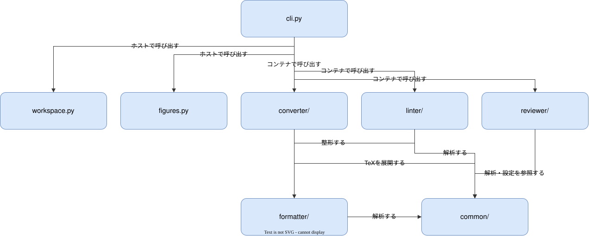

# Pythonモジュール

定義元: [CLI](../../../src/drafter/cli.py)、[パッケージ設定](../../../pyproject.toml)。

[モジュール図の編集元](diagrams/modules.drawio)

| モジュール | 責務 | 主な依存 |
|---|---|---|
| `cli.py` | 公開コマンド、Compose転送、論文別設定の解決 | workspace・figures・各pipeline |
| `workspace.py` | 論文ひな型生成、対話セットアップ、Windowsパス変換 | Click・dotenv・ホストコマンド |
| `figures.py` | ソースの出力指定を読み、図生成ツールを起動 | drawio・mmdc・uv |
| `linter/` | TeX整形とPandoc互換検査 | formatter・common |
| `formatter/` | 空白・空行・和文約物の正規化 | common |
| `converter/` | 入力展開・DOCX変換・Wordテンプレート生成 | common・Pandoc |
| `reviewer/` | 分割・ルール適用・LLM校閲・レポート生成 | common・OpenAI互換API |
| `common/` | TeX解析とLLM設定 | YAML・環境変数 |

依存方向は呼び出し元から呼び出し先。PDF生成のlatexmk呼び出しはCLIが担当する。
既存の`python -m drafter.<module>.pipeline`も直接起動できる。
