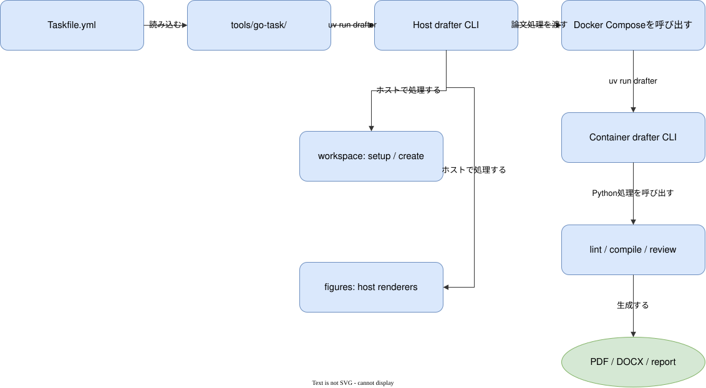

# リポジトリ構成

定義元: [Taskfile](../../Taskfile.yml)、[Compose](../../docker-compose.yml)、
[CLI](../../src/drafter/cli.py)。

[構成図の編集元](diagrams/overview.drawio)

| 配置 | 責務 |
|---|---|
| `Taskfile.yml` | タスクの入口、共通のCompose／uv呼び出し |
| `tools/go-task/<機能>/<機能>.yml` | 機能別の引数・CLI呼び出し。配線は[専用README](../../tools/go-task/README.md) |
| `src/drafter/` | CLIと論文処理。[モジュール構成](drafter/modules.md) |
| `templates/rules/` | AI校閲用の章構成ルール |
| `templates/pandoc/` | Pandocの変換設定 |
| `templates/msword/` | 生成するWordテンプレート（追跡対象外） |
| `papers/` | コンテナ内の論文・共有bib。ホスト実体は`.env`で指定 |
| `figures/` | draw.io・Mermaid・Pythonの図ソースと出力（追跡対象外） |
| `config/` | LLM設定例。実設定は追跡対象外 |
| `tests/` | Python処理・CLI・Task配線のテスト |
| `scripts/` | 論文生成の結合検証 |
| `docs/` | 構成・運用手順と文書用の図 |

## 実行境界

Taskから`uv run drafter <subcommand>`を呼ぶ。create-paper・setup・generate-figureはホストで実行する。
compile・lint・review・templatesは、ホストCLIがComposeへ引き渡し、コンテナCLIが処理する。
`DRAFTER_IN_CONTAINER=1`で再転送を防ぐ。この値はコンテナイメージで設定する。

Composeは論文を`/workspace/papers`、共有bibを`/workspace/papers/bib`、
フォントを`/usr/share/fonts/ms-fonts`へマウントする。bibとフォントは読み取り専用。
ホストのuv環境とコンテナの`/opt/drafter-venv`は分離する。

旧開発環境設定の撤去、VS Code／chktexの統合は今後整備する。
