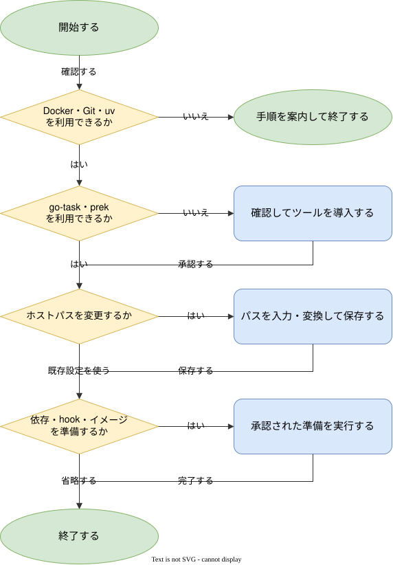

# セットアップ

定義元: [セットアップ処理](../../src/drafter/workspace.py)、
[CLI](../../src/drafter/cli.py)、[環境変数例](../../.env.example)。

Phase 1で起動環境、Phase 2でOSとパス、Phase 3で依存・ビルドを準備する。

[フロー図の編集元](../../tools/go-task/setup/diagrams/flow.drawio)



## Phase 1: 起動環境

### STEP 1: Docker・Git・uvを導入する

Docker Compose v2、Git、[uv](https://docs.astral.sh/uv/getting-started/installation/)を事前に用意する。
WSLではLinux側にuvを入れ、Docker DesktopのWSL連携を有効にする。

```bash
docker compose version
docker info
uv --version
```

確認事項: Docker daemonへ接続できること。TeX／Pandocのホスト導入は不要。

### STEP 2: CLIを確認する

リポジトリルートで実行する。uvはPythonとロック済み依存を必要に応じて取得する。

```bash
uv run drafter --help
```

確認事項: `setup`・`create-paper`・`compile`などのサブコマンドが表示されること。

## Phase 2: OSとホストパス

### STEP 1: 対象OSを指定する

```bash
uv run drafter setup --os macos
# またはWSL内で
uv run drafter setup --os wsl
```

go-task導入済みなら`task setup os=macos`／`task setup os=wsl`でも同じ処理を実行する。
確認事項: go-taskやprekの導入前に確認が表示されること。
macOSのgo-taskは`brew install go-task`、WSLは公式インストーラーを使用する。
macOSでbrewがない場合は[Homebrew](https://brew.sh/)を事前導入する。

### STEP 2: ディレクトリを入力する

| 入力 | 用途 |
|---|---|
| `PAPERS_DIR` | 論文ディレクトリ群の親 |
| `BIB_DIR` | 共有BibTeXファイル群 |
| `FONTS_DIR` | `times.ttf`・`msmincho.ttc`などのフォント |

macOSは絶対パス、WSLは`C:\Users\name\Documents\papers`などのWindowsパスを入力できる。
WSLのWindowsパスは`wslpath -u`で変換し、存在確認後に`.env`へ保存する。
日本語・空白入りパスに対応する。存在しないディレクトリは作成前に確認する。
既存`.env`は変更するか確認し、変更時も他の設定キーを保持する。

確認事項: `.env`に3つのパスがあり、フォント・bibの実体を参照していること。
フォントファイル自体は利用者が用意する。論文のフォント参照は
`Path=/usr/share/fonts/ms-fonts/`とする。

## Phase 3: 開発依存とビルド

### STEP 1: 確認して準備を進める

setup内で順に確認される。不要な操作はスキップできる。

```bash
uv sync --locked
prek install
task docker:build
```

確認事項: 承認した操作だけが実行されること。イメージ内にCLIがインストールされること。

### STEP 2: 論文を作成して出力する

```bash
task create:paper paper='日本語の 論文'
task compile:pdf paper='日本語の 論文'
task compile:docx paper='日本語の 論文'
```

確認事項: 指定した`PAPERS_DIR`配下に論文が作成され、`dist/`に成果物が生成されること。

## 前提

対象はmacOSとWSL。uvの初回起動によるPython・依存の取得はsetup開始前に行われる。
API設定は`config/drafter.yaml.example`を参照する。
draw.io・Mermaid CLI・PlantUMLはホストへ事前導入する。setupでは検証・導入しない。
[図の生成](figures.md)を参照する。
