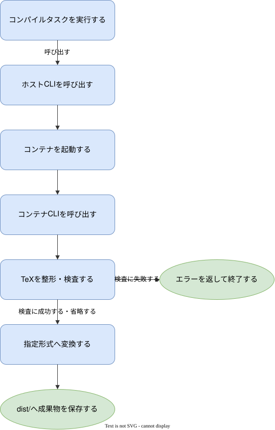

# compile

定義元: [compile.yml](compile.yml)、[Python CLI](../../../src/drafter/cli.py)。

ホストCLIがComposeへ渡し、コンテナCLIがlint後にlatexmkまたはconverterを実行する。

| 入口 | 呼び出し | 処理本体 |
|---|---|---|
| `compile:pdf／compile:docx` | `uv run drafter compile --paper ... --to ...` | `cli.compile_paper` |

[フロー図の編集元](diagrams/flow.drawio)

## 入力

- paper: 論文名（必須）
- to: pdf／docx（task compileのみ、既定pdf）
- format: article／short／review（既定article）
- main_tex: 入力名（既定main.tex）
- word_template／word_template_dir: Wordテンプレート
- skip_lint: 0／1（既定0）

`compile:templates`は`uv run drafter templates`をコンテナ内で実行する。
`word_template_dir`を指定すると`--output-dir`へ渡す。

論文設定はCLI > 環境変数／`.env` > `paper.yml` > 既定値の順。
lint失敗・外部ツール失敗は終了コードで呼び出し元へ返す。

[Task一覧へ戻る](../README.md)
