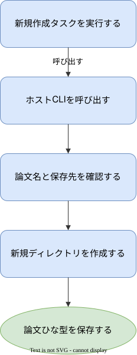

# create

定義元: [create.yml](create.yml)、[Python CLI](../../../src/drafter/cli.py)。

ホストのPAPERS_DIR直下にmain.tex・5章・paper.yml・.latexmkrcを生成する。既存パスは上書きしない。

| 入口 | 呼び出し | 処理本体 |
|---|---|---|
| `create:paper paper=...` | `uv run drafter create-paper --paper ...` | `workspace.create_paper` |

[フロー図の編集元](diagrams/flow.drawio)

## 入力

- paper: 論文ディレクトリ名（必須、日本語・空白可）

[Task一覧へ戻る](../README.md)
