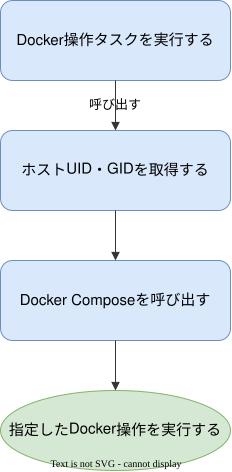

# docker

定義元: [docker.yml](docker.yml)、[Python CLI](../../../src/drafter/cli.py)。

Python CLIを経由せず、ホストでDocker Composeを実行する。UID/GIDは自動取得する。

| 入口 | 呼び出し | 処理本体 |
|---|---|---|
| `docker:build／up／down／bash` | `docker compose ...` | `Composeサービスdrafter` |

[フロー図の編集元](diagrams/flow.drawio)

## 入力

- DOCKER_COMPOSE: 呼び出しコマンド（既定docker compose）

[Task一覧へ戻る](../README.md)
