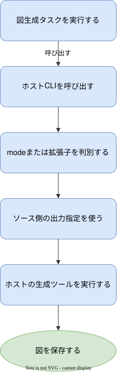

# generate

定義元: [generate.yml](generate.yml)、[Python CLI](../../../src/drafter/cli.py)。

ホストで拡張子を判定し、drawio・mmdc・plantuml・uvを直接起動する。出力名はソース側で指定する。

| 入口 | 呼び出し | 処理本体 |
|---|---|---|
| `generate:fig path=...` | `uv run drafter generate-figure --path ...` | `figures.render` |

[フロー図の編集元](diagrams/flow.drawio)

## 入力

- path: figures/配下のソース（必須）
- generate:fig:<mode>: drawio／mermaid／plantuml／pythonを明示指定

`.drawio`・`.mmd`／`.mermaid`・`.puml`／`.plantuml`・`.py`を判別する。
ホストの描画ツールは事前導入を前提とし、setup／生成時の事前検証は行わない。
[ソースの出力設定](../../../docs/operations/figures.md)を参照。

[Task一覧へ戻る](../README.md)
