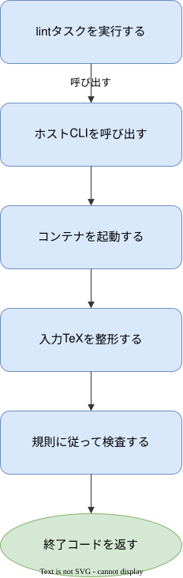

# lint

定義元: [lint.yml](lint.yml)、[Python CLI](../../../src/drafter/cli.py)。

TeX整形とPandoc互換検査。入力を書き換える。skip_lintの設定に関係なく実行する。

| 入口 | 呼び出し | 処理本体 |
|---|---|---|
| `lint paper=...` | `uv run drafter lint --paper ...` | `linter.pipeline.run` |

[フロー図の編集元](diagrams/flow.drawio)

## 入力

- paper: 論文名（必須）
- main_tex: 入力名（既定main.tex）

論文設定はCLI > 環境変数／`.env` > `paper.yml` > 既定値の順。
lint失敗・外部ツール失敗は終了コードで呼び出し元へ返す。

[Task一覧へ戻る](../README.md)
