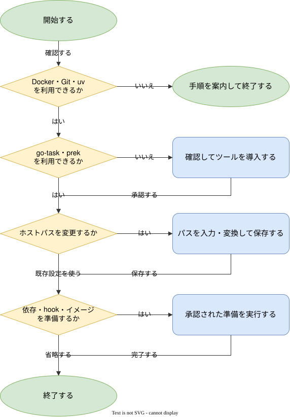

# setup

定義元: [setup.yml](setup.yml)、[Python CLI](../../../src/drafter/cli.py)。

Docker・Git・uvを前提に、go-task／prekの導入、パス設定、hook・ビルドを対話確認する。

| 入口 | 呼び出し | 処理本体 |
|---|---|---|
| `setup os=macos\|wsl` | `uv run drafter setup --os ...` | `workspace.setup_workspace` |

[フロー図の編集元](diagrams/flow.drawio)

## 入力

- os: macos／wsl（必須）

[セットアップ手順](../../../docs/operations/setup.md)を参照。

[Task一覧へ戻る](../README.md)
